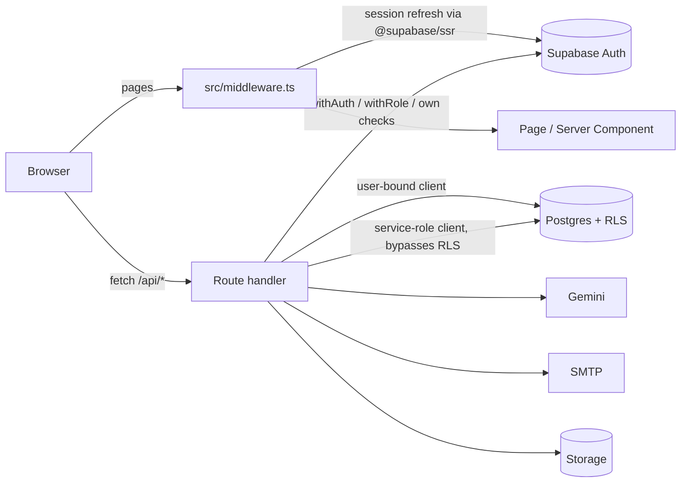

# CampusSync architecture

A short, code-derived description of the system as it exists. Counts below were taken from the source tree
(100 API route files, about 138 exported HTTP handlers, 38 `page.tsx` files, 27 tables referenced through
`.from('...')`). Anything not listed here is not implemented.

## Stack

- Next.js 15 (App Router) with React 19 and TypeScript; Tailwind CSS 4; Radix UI primitives.
- Supabase: Auth (email/password, Google OAuth), PostgreSQL, Storage, Realtime (client-side subscriptions).
- Google Gemini (`@google/generative-ai`) for certificate field extraction.
- `jose` for signing and verifying credentials (JWS); `nodemailer` for SMTP email; `jspdf` / `pdf-lib` for PDFs.
- Tests: Vitest. CI: GitHub Actions (typecheck, lint, tests, audit, gitleaks, CodeQL).
- There are no Next.js Server Actions in the code; all mutations go through `src/app/api/**` route handlers.

## Directory map (`my-app/`)

| Path | Contents |
|------|----------|
| `src/app/` | Pages (`page.tsx`), layouts and `api/` route handlers. Sections: `admin`, `faculty`, `student`, `recruiter`, `organizations`, `login`, `signup`, `onboarding`, `waiting`, `reset-password`, `public`, `setup`. |
| `src/app/api/` | 93 `route.ts` files: `admin` (16), `recruiter` (14), `auth` (14), `certificates` (12), `v2` (11, super-admin organization management and org context), plus smaller groups (`analytics`, `health`, `vcs`, `organizations`, ...). The former `documents` API, `webhooks/verification` and `recruiter/saved-searches` / `recruiter/verify-certificate` routes were removed (see [DATABASE-SCHEMA.md](DATABASE-SCHEMA.md)). |
| `src/lib/api/` | Route helpers: `withAuth`, `withRole`, `withErrorHandler`, response helpers, validation, organization and recruiter context resolution. |
| `src/lib/supabaseServer.ts` | Cookie-bound server client, service-role admin client, `getServerUserWithRole`, `requireRole`. |
| `src/lib/supabase/middleware.ts` | Session refresh used by `src/middleware.ts`. |
| `src/lib/vc.ts`, `src/lib/vc/` | Credential signing/verification helpers (`vc.ts` is what the routes use). |
| `src/lib/ocr/`, `ocrExtract.ts`, `docExtractors.ts` | Extraction helpers around Gemini. |
| `src/lib/rateLimit.ts` | In-memory, per-process rate limiter. |
| `src/lib/emailService.ts` | SMTP email sending. |
| `src/components/` | UI components (`ui/`, `layout/`, `admin/`, `features/`), `ErrorBoundary`, `OrganizationSwitcher`. |
| `src/contexts/OrganizationContext.tsx` | Client-side current-organization state. |
| `src/middleware.ts` | Next.js middleware (see below). |
| `supabase/migrations/` | **Draft** SQL only (lockdown and hardening proposals). The original schema and RLS policies are not in this repo. |
| `tests/` | Vitest tests; `tests/security/route-inventory.test.ts` guards API route authentication. |
| `scripts/` | `setup-superadmin.mjs`, `db-audit.js` (see `scripts/README.md`). |

## Request flow

- **Middleware** (`src/middleware.ts`, matcher `/((?!_next/|api/|.*\..*).*)`) refreshes the Supabase session,
  redirects unauthenticated visitors of non-public pages to `/login`, redirects signed-in users away from
  `/login` and `/signup`, sends faculty/recruiters whose `user_roles.approval_status` is `pending`/`denied` to their
  waiting page, returns 404 for `/test-*` and `/debug-*` in production, and returns 503 in production if critical
  env vars are missing. It does **not** enforce per-role page access (no 403s) and it does **not** run for `/api/*`.
- **`/api/*` bypasses the middleware.** Every route must authenticate for itself. Most use `withAuth` / `withRole`
  or call `supabase.auth.getUser()`; the deliberately public ones are listed, with reasons, in
  `tests/security/route-inventory.test.ts`.
- **35 route files use the service-role client** (`createSupabaseAdminClient` or `SUPABASE_SERVICE_ROLE_KEY`). For
  those, RLS does not apply and the route's own checks are the only protection.

## Authentication and authorization model

- Authentication: Supabase Auth. Sessions are stored by `@supabase/ssr` in cookies that are readable by
  JavaScript (not HttpOnly). Routes verify the user with `supabase.auth.getUser()` (validated server-side), not by
  trusting the cookie contents.
- Roles live in `user_roles (user_id, role, organization_id, approval_status)`:
  `student`, `faculty`, `admin`, `recruiter`, `org_admin`, `super_admin` (6 roles). A user can have several rows.
  `approval_status` is `pending | approved | denied`; `requireRole` refuses `pending`/`denied` rows.
- **Global role versus org scope.** `getServerUserWithRole()` / `requireRole()` / `withRole()` pick the user's
  highest-priority role across *all* of their `user_roles` rows
  (`super_admin > org_admin > admin > faculty > recruiter > student`) regardless of organization. So `withRole`
  answers "does this user hold this role anywhere", not "in this organization". Organization scoping is a second
  step: `getOrganizationContext(user, requestedOrgId)` (`src/lib/api/utils/organization.ts`) resolves the
  organization from the `X-Organization-ID` header / body (verifying a `user_roles` row for that org) or the user's
  first role row; super admins may select any organization; recruiters get an `accessibleOrganizations` list from
  their approved per-organization `user_roles` rows. A route that checks `withRole` but forgets the organization step can act across tenants,
  so new multi-tenant routes must do both.
- Row-Level Security is the intended second layer for user-bound clients. Policies are not in this repository
  (see the database section).

## Certificate lifecycle

1. **Upload and extraction** (`POST /api/certificates/ocr-gemini`, authenticated, per-user rate limit): accepts
   JPEG/PNG/WebP/PDF up to 10 MB, stores the file in the `certificates` storage bucket under `<user id>/...`,
   sends the content to Gemini and returns extracted fields. The result is advisory.
2. **Create** (`POST /api/certificates/create`): inserts a `certificates` row for the student with
   `verification_status = 'pending'`. The file URL must be in our storage under the caller's folder.
3. **Review** (`/api/certificates/pending`, `approve`, `batch-approve`, `approve/batch`, `revert-approval`):
   faculty / admins set `verification_status` to `verified` or `rejected`, optionally writing
   `certificate_metadata`, and write `audit_logs` entries. `certificates` also has a `status` column
   (`pending | approved | rejected`) in addition to `verification_status` (`pending | verified | rejected`); both
   have CHECK constraints in the live database.
4. **Issue credential** (`POST /api/certificates/issue`): only for `verification_status = 'verified'`; the credential
   subject is rebuilt from the stored certificate (client-supplied claims are ignored) and the caller must be the
   owner or a reviewer in the certificate's organization.

## Credential lifecycle

1. **Issue.** `signCredential()` (`src/lib/vc.ts`) builds a W3C VC Data Model 1.0 style document
   (`type: [VerifiableCredential, AchievementCredential]`) and signs `{ vc }` as a compact JWS with `jose`. The
   algorithm and key id come from `VC_ISSUER_JWK` (`alg`/`kid`); the algorithm is not fixed in code. The credential
   is stored in `verifiable_credentials` (`id`, `student_id`, `issuer`, `issuance_date`, `credential`, `status =
   'active'`). Credentials carry no expiry claim. In production a development placeholder key makes issuing fail.
2. **Verify.** Public, rate-limited endpoints (`/api/vcs/verify`, `/api/certificates/verify`,
   `/api/recruiter/verify-credential`) check the JWS against the configured issuer key and the stored status.
   Verification uses the single configured key: after a key rotation, credentials signed with the old key stop
   verifying.
3. **Revoke.** `POST /api/vcs/revoke` sets `status = 'revoked'`, `revoked_at`, `revoked_reason`. The route also
   tries to insert into `revocation_list`, which **does not exist** in the production database (the error is
   logged and ignored); `verifiable_credentials.status` is the source of truth. See
   `supabase/migrations/20261014_core_revocation_list_note.sql`.
4. There is no uniqueness guarantee yet of one active credential per certificate; a draft migration adds it.

## Data stores

Tables referenced in code through `.from('<table>')`: `allowed_domains`, `audit_logs`, `certificates`,
`organization_domains`, `organizations`, `profiles`, `recruiter_contacts`, `recruiter_favorites`,
`recruiter_pipeline`, `role_requests`, `sd_issuances`, `tlog_entries`, `tlog_tree_heads`, `trusted_issuers`,
`user_roles`, `verifiable_credentials`.
The code no longer reads or writes `documents`, `document_metadata`, `certificate_metadata`, `verification_results`,
`verification_requests` or `saved_searches` (the documents subsystem, the verification webhook and the saved-search /
recruiter-flag routes were removed). `/api/analytics/dashboard` and `/api/analytics/faculty` are computed from
`certificates` only (`confidence_score`, `auto_approved`, `verification_method`, `verification_details`).
RPC functions called: `check_and_reserve_slug`, `generate_organization_slug`, `transfer_primary_admin`,
`allocate_status_index`, `set_status_bit`, `tlog_append`. The full target schema is in `DATABASE-SCHEMA.md`.

Storage: bucket `certificates` (override with `NEXT_PUBLIC_CERTIFICATES_BUCKET` where read). Realtime: the
`waiting`, `faculty/waiting` and `recruiter/waiting` pages and `FacultyApprovalManager` subscribe to changes.

### Database security model (observed 2026-10-14)

Observed in production by the owner (the policy text is intentionally not reproduced here):

- RLS is **enabled** on `certificates`, `profiles`, `role_requests`, `user_roles` and `verifiable_credentials`.
- The database policy set was reviewed and tightened by the SQL in `my-app/supabase/migrations/` (drafts: review against the live schema before applying). Specifics are intentionally not described in this public repository.
- Constraints present: `certificates.status` and `verification_status` CHECKs; `user_roles` unique on
  `(user_id, organization_id)` (nulls not distinct), role CHECK over the 6 roles, `approval_status` CHECK, and a
  `check_primary_admin_role` rule (primary admin must be `org_admin`); `verifiable_credentials` has only a primary
  key and a `student_id` foreign key.
- The storage bucket `certificates` is **public**.
- `revocation_list` does not exist.
- The migrations in `supabase/migrations/` are **drafts**: review them against the live schema before applying.
  Original schema and policies are not in this repo; export them with the Supabase CLI (`supabase db dump`) to
  version them.

## External services

Supabase (Auth, DB, Storage, Realtime), Google Gemini API (certificate images/PDFs are sent to Google), an SMTP
server (optional), and Google OAuth via Supabase. Optional OCR service (`OCR_SERVICE_URL`), and OpenAI/Anthropic
keys exist in the code for alternative extractors but are only used if configured.

## Environment variables

Read in code: `NEXT_PUBLIC_SUPABASE_URL`, `NEXT_PUBLIC_SUPABASE_ANON_KEY`, `SUPABASE_SERVICE_ROLE_KEY` (server only),
`NEXT_PUBLIC_SITE_URL`, `NEXT_PUBLIC_BASE_URL`, `VC_ISSUER_JWK` (server only, private key),
`NEXT_PUBLIC_ISSUER_DID`, `NEXT_PUBLIC_ISSUER_VERIFICATION_METHOD`, `GEMINI_API_KEY`, `GEMINI_MODEL`, `OCR_ENABLED`,
`OCR_SERVICE_URL`, `OPENAI_API_KEY`, `ANTHROPIC_API_KEY`, `SMTP_HOST`, `SMTP_PORT`, `SMTP_SECURE`, `SMTP_USER`,
`SMTP_PASS`, `SMTP_FROM`, `NEXT_PUBLIC_CERTIFICATES_BUCKET`,
`ENABLE_MONITORING`. Template with comments: [`.env.example`](../.env.example). `NEXT_PUBLIC_*` values are shipped to
the browser; a test fails if such a name contains `SERVICE`, `SECRET` or `PRIVATE`.

## Known limitations

- Rate limiting is in-memory and per instance (ineffective as a global limit on serverless).
- RLS and schema SQL are not in the repository; behaviour that depends on them cannot be reviewed here.
- `withRole` is global-role based; organization scoping is a separate, per-route step.
- Session cookies are not HttpOnly (a property of `@supabase/ssr`'s browser client).
- No external error tracking, alerting or metrics; the in-memory error monitor is per process.
- AI extraction is advisory and can be wrong; certificates are sent to Google's API.
- Single issuer key; credentials have no expiry and no key-rotation history (old credentials fail after rotation).
- Public bucket `certificates` exposes uploaded files to anyone with the URL.
