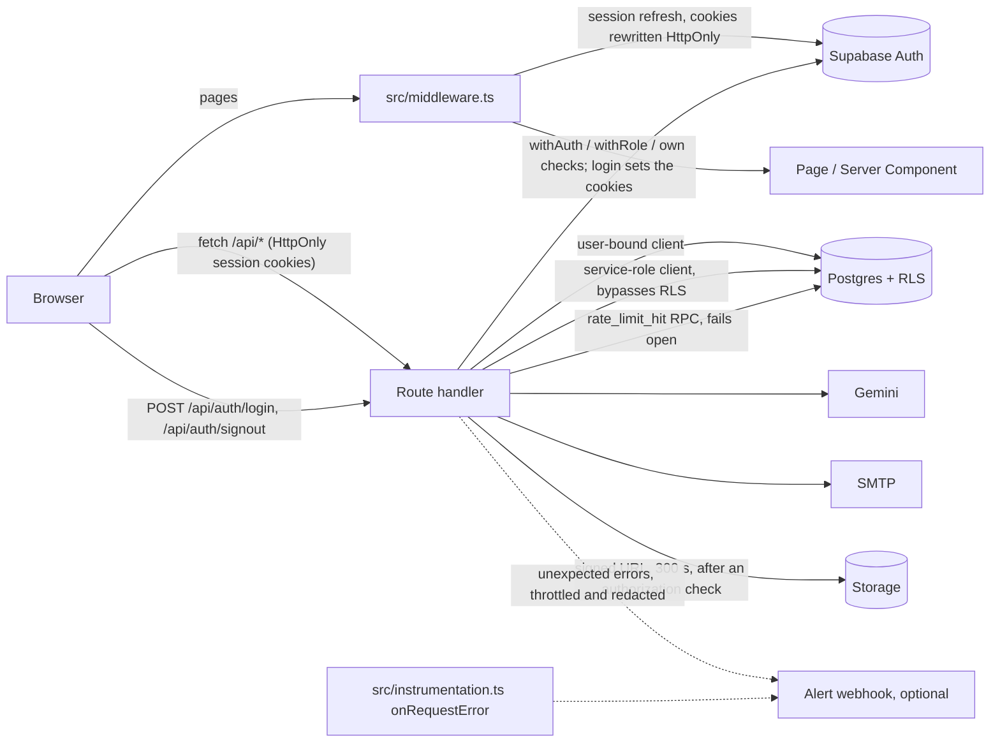

# CampusSync architecture

A short, code-derived description of the system as it exists. Counts below were taken from the source tree
(100 API route files under `src/app/api` exporting 134 HTTP handlers, 39 `page.tsx` files, 17 tables referenced
through `.from('...')` or the status-list constant, 13 of them core; the optional rate-limit table `rate_limits` is
reached only through an RPC). Anything not listed here is not implemented.

## Stack

- Next.js 15 (App Router) with React 19 and TypeScript; Tailwind CSS 4; Radix UI primitives.
- Supabase: Auth (email/password, Google OAuth), PostgreSQL, Storage. All Supabase clients run on the server; there is
  no Supabase client and no realtime subscription in the browser.
- Google Gemini (`@google/generative-ai`) for certificate field extraction.
- `jose` for signing and verifying credentials (JWS); `nodemailer` for SMTP email; `jspdf` / `pdf-lib` for PDFs.
- Tests: Vitest (run `npm test` in `my-app/`). CI: GitHub Actions (typecheck, lint, tests, a production build, the migration model checks, a dependency audit gate, gitleaks; CodeQL in its own workflow).
- There are no Next.js Server Actions in the code; all mutations go through route handlers (`src/app/api/**`, plus
  `src/app/auth/confirm` and the two `/.well-known/*` documents).

## Directory map (`my-app/`)

| Path | Contents |
|------|----------|
| `src/app/` | Pages (`page.tsx`), layouts and `api/` route handlers. Sections: `admin`, `faculty`, `student`, `recruiter`, `organizations`, `login`, `signup`, `onboarding`, `waiting`, `reset-password`, `public`, `setup`, `verify`, `transparency`, `dashboard`, plus `auth/confirm` (email confirmation) and `.well-known/` (`did.json`, `jwks.json`). |
| `src/app/api/` | 100 `route.ts` files: `admin` (17, including `admin/vcs/resign`), `recruiter` (14), `auth` (19, including `login`, `signout` and `password-reset/{request,verify,update}`), `certificates` (13, including `[id]/file`), `v2` (11, super-admin organization management and org context), `transparency` (4), and smaller groups (`analytics`, `credentials/sd`, `health`, `organizations`, `vcs`, `status`, `public`, `portfolio`, ...). The former `documents` API, `webhooks/verification` and `recruiter/saved-searches` / `recruiter/verify-certificate` routes were removed (see [DATABASE-SCHEMA.md](DATABASE-SCHEMA.md)). |
| `src/lib/api/` | Route helpers: `middleware/` (`withAuth`, `withRole`, `withSession`, `withSuperAdmin`, `withErrorHandler`), `utils/` (response helpers, validation, `authorize.ts` with `authorizeOrg`, `organization.ts` and `recruiter.ts` context resolution, `audit.ts` with `writeAudit`, role-change helpers). |
| `src/lib/supabaseServer.ts` | Cookie-bound server client, service-role admin client, `getServerUserWithRole`, `requireRole`. |
| `src/lib/supabase/` | `server.ts` (server client), `middleware.ts` (session refresh used by `src/middleware.ts`) and `cookieOptions.ts` (the HttpOnly / SameSite / Secure options passed to every server client). There is no browser client. See [SESSION-COOKIES.md](SESSION-COOKIES.md). |
| `src/lib/auth/` | Server-side login helpers: `postLogin.ts` (role and redirect decision used by `POST /api/auth/login`), `passwordRules.ts`, `findUserByEmail.ts`. `src/lib/authEvents.ts` signals login/logout between tabs. |
| `src/hooks/` | `usePolling.ts` (visibility-aware polling used by the waiting pages) and `useSignedFileUrl.ts` (on-demand signed URL for a certificate file). |
| `src/instrumentation.ts` | Next.js `onRequestError` hook: raises a throttled, redacted alert for unhandled errors. |
| `src/lib/alerts.ts` | Webhook alerting (`ALERT_WEBHOOK_URL`): throttling, redaction, `reportError` / `reportEvent`; fed by `logger.error`. See [MONITORING.md](MONITORING.md). |
| `src/lib/services/` | `certificateService.ts` (review state machine, credential issuance and revocation), `storageUrl.ts` (certificate file URL parsing), `certificateFile.ts` (who may open a certificate file, 300 s signed URL). |
| `src/lib/vc.ts`, `vcVerify.ts`, `vcId.ts`, `signing.ts`, `vcResign.ts` | Credential signing, key handling (current key plus previous public keys), the shared verification service used by every public verify endpoint, and the re-sign routine behind `POST /api/admin/vcs/resign` (issuer key rotation, see [KEY-ROTATION.md](KEY-ROTATION.md)). |
| `src/lib/statusList.ts`, `merkle.ts`, `transparencyLog.ts`, `tlogVerify.ts`, `sdjwt.ts` | Optional features (revocation status list, transparency log, SD-JWT), all off by default. |
| `src/lib/offlineVerify/` | Byte-identical copy of the offline verifier (`../verifier/src`), bundled for the `/verify` page; kept in sync by `scripts/sync-verifier.mjs`. |
| `src/lib/privacy/` | Student visibility flags, recruiter access wrapper (`recruiterRoute`), PII-read audit, input sanitising, PDF text helpers. |
| `src/lib/analytics/`, `uploadValidation.ts` | Certificate analytics helpers; upload MIME/magic-byte checks and model-output normalisation for the OCR route. |
| `src/lib/rateLimit.ts`, `rateLimitGlobal.ts` | The in-memory, per-process rate limiter, and the Postgres-backed global limiter (`rate_limit_hit` RPC, fails open to the in-memory one). See [RATE-LIMITING.md](RATE-LIMITING.md). |
| `src/lib/emailService.ts`, `emailValidation.ts` | SMTP email sending; email/domain validation. |
| `src/lib/envValidator.ts`, `envServer.ts`, `runtimeEnvCheck.ts` | Environment access, feature flags and the health report. |
| `src/components/` | UI components (`ui/`, `layout/`, `features/signup/`), `ErrorBoundary`, `OrganizationSwitcher`, `LogoutButton` (posts to `/api/auth/signout`), `CertificateFileLink`. |
| `src/contexts/OrganizationContext.tsx` | Client-side current-organization state (loaded from `/api/auth/me` and the organization routes; no auth-state listener). |
| `src/middleware.ts` | Next.js middleware (see below). |
| `supabase/migrations/` | Versioned SQL patches (`20261014_*` patches, `20261015_*` schema cleanup, `20261016_*` private bucket and rate limits). They are **not** a complete baseline dump of the original schema, which is not in this repository. Which of them are applied: see [DATABASE-SCHEMA.md](DATABASE-SCHEMA.md), section "Migration status". |
| `supabase/tests/` | A model of the production schema and the assertions the cleanup migrations are tested with (in-process PostgreSQL); see its `README.md`. |
| `tests/` | Vitest tests; `tests/security/route-inventory.test.ts` guards API route authentication. |
| `scripts/` | `setup-superadmin.mjs`, `generate-issuer-key.mjs`, `audit-check.mjs`, `sync-verifier.mjs`, benchmarks (see `scripts/README.md`). |

## Request flow

The browser holds no Supabase client: sign-in, sign-out and password reset are server routes, and the session lives only
in HttpOnly cookies ([SESSION-COOKIES.md](SESSION-COOKIES.md)).

- **Middleware** (`src/middleware.ts`) runs on page routes; its matcher skips `_next` assets, `favicon.ico`, `/api/*` and
  paths ending in common static file extensions (`/.well-known/*` is matched and treated as public). It refreshes the
  Supabase session, redirects to `/setup` when the Supabase URL / anon key are not configured, redirects
  unauthenticated visitors of non-public pages to `/login`, redirects signed-in users away from `/login` and
  `/signup`, sends faculty/recruiters whose `user_roles.approval_status` is `pending` (or `denied`, on their own
  section) to their waiting page, and returns 404 for `/test-*` and `/debug-*` in production. It does **not**
  enforce per-role page access (no 403s) and it does **not** run for `/api/*`.
- **`/api/*` bypasses the middleware.** Every route must authenticate for itself. 72 of the 100 route files contain a
  recognised guard (see "Guards in use" below); the 28 deliberately public ones (pre-login flows such as `auth/login`,
  `auth/signout` and `auth/password-reset/{request,verify}`, public verification, health) are listed, with reasons, in
  `tests/security/route-inventory.test.ts`.
- **44 route files call `createSupabaseAdminClient()`** (the service-role client) and a few more build one directly or
  reach it through shared helpers (`writeAudit`, `recruiterRoute`, the global rate limiter, the signed-URL helper). For
  those, RLS does not apply and the route's own checks are the only protection.

## Authentication and authorization model

- Authentication: Supabase Auth. The session is kept only in HttpOnly cookies that the server writes
  (`SameSite=Lax`, `Secure` outside `next dev`; options in `src/lib/supabase/cookieOptions.ts`). Email + password
  login is `POST /api/auth/login`, logout is `POST /api/auth/signout`, password reset runs through
  `/api/auth/password-reset/*`, Google login through `/api/auth/oauth/google` and `/api/auth/callback`; none of them
  returns a token to the page. Routes verify the user with `supabase.auth.getUser()` (validated server-side), not by
  trusting the cookie contents. Details: [SESSION-COOKIES.md](SESSION-COOKIES.md).
- Authorization comes only from `user_roles (user_id, role, organization_id, approval_status)`; `profiles` holds
  profile data only. Roles: `student`, `faculty`, `admin`, `recruiter`, `org_admin`, `super_admin` (6 roles). A user
  can have several rows. `approval_status` is `pending | approved | denied`; pending/denied rows grant nothing. A
  recruiter has one platform-level row (`organization_id` NULL) and one approved row per organization they may access.
- **Global role versus org scope.** `getServerUserWithRole()` / `requireRole()` / `withRole()` pick the user's
  highest-priority role among their *approved* `user_roles` rows
  (`super_admin > org_admin > admin > faculty > recruiter > student`) regardless of organization. So `withRole`
  answers "does this user hold this role anywhere", not "in this organization". Organization scoping is a second
  step: `authorizeOrg()` (`src/lib/api/utils/authorize.ts`) checks an approved role of sufficient rank in a given
  organization; `getOrganizationContext(user, requestedOrgId)` (`src/lib/api/utils/organization.ts`) resolves the
  organization from the `X-Organization-ID` header / body (verifying an approved `user_roles` row for that org) or
  falls back to the user's highest-privilege approved row; super admins may select any organization; recruiters get
  an `accessibleOrganizations` list from their approved per-organization rows. A route that checks `withRole` but
  forgets the organization step is not tenant-scoped, so new multi-tenant routes must do both.
- Row-Level Security is the second layer for user-bound clients. Writes that need more than a user may do (credentials,
  audit rows, role changes) go through the backend with the service-role client after the route's own authorization.

### Guards in use

Number of route files (under `src/app/api`) that use each helper; a file can use several:

| Helper | Route files |
|--------|------------:|
| `withRole` | 23 |
| `withSuperAdmin` | 14 |
| `withSession` | 13 |
| `resolveAdminOrg` | 15 |
| `recruiterRoute` | 9 |
| `withAuth` | 8 |
| `authorizeOrg` | 7 |
| `assertSuperAdmin` | 5 |
| direct `auth.getUser()` | 11 |
| `getServerUserWithRole` | 1 |
| `withErrorHandler` | 0 |

Related helper usage: `writeAudit` in 26 route files, `enforceRateLimit` (in-memory) in 23, `enforceGlobalRateLimit`
(Postgres-backed) in 12, `getOrganizationContext` in 6.

## Certificate lifecycle

1. **Upload and extraction** (`POST /api/certificates/ocr-gemini`): only approved students that belong to an organization;
   per-user rate limits (6 per minute, 50 per day). Accepts JPEG/PNG/WebP/PDF up to 10 MB (declared type, extension
   and magic bytes must agree), sends the content to Gemini first, and only after a successful parse stores the file
   in the `certificates` storage bucket under `<user id>/...`; returns the extracted fields. The route makes no
   database writes. The result is advisory. The OCR route is also rate limited globally (see
   [RATE-LIMITING.md](RATE-LIMITING.md)).
2. **Create** (`POST /api/certificates/create`): inserts a `certificates` row for the student with
   `verification_status = 'pending'`. The file URL must be in our storage under the caller's folder; the object path is
   also stored in `storage_path`.
   **View the file** (`GET /api/certificates/[id]/file`): the UI asks for a signed URL each time the user clicks "view".
   The server checks that the caller is the owner, an approved faculty / admin / org_admin of the certificate's
   organization, or an approved super admin, and returns a URL valid for 300 seconds (`Cache-Control: no-store`). Every
   other case gets the same 404. Recruiters never receive files. See [PRIVATE-STORAGE.md](PRIVATE-STORAGE.md).
3. **Review** (`/api/certificates/pending`, `approve`, `batch-approve`, `revert-approval`): faculty / admins move the
   certificate through the state machine in `certificateService.ts` (`pending -> verified | rejected`,
   `verified -> pending` on revert, `verified -> rejected`, `rejected -> pending`). The caller must hold an approved
   reviewer role in the certificate's organization and cannot review their own certificate. `verification_status`
   (`pending | verified | rejected`) is the only status column; there is no legacy `status` column.
   An approval sets `faculty_id` and `verification_method = 'manual'`; `reviewed_at` is set by a database trigger.
   Every transition writes an `audit_logs` row, and leaving `verified` revokes the certificate's active credentials
   (and rolls the status change back if revocation fails). `GET /api/certificates/approval-history` lists these audit
   rows and is open to faculty, admin, org_admin and super_admin, each within the organization they hold an approved
   role in.
4. **Issue credential** (`POST /api/certificates/issue`, or `issue: true` on `approve`): only for
   `verification_status = 'verified'`; the credential subject is rebuilt from the stored certificate (client-supplied
   claims are ignored) and the caller must be the owner or a reviewer in the certificate's organization.
5. **Delete** (`DELETE /api/certificates/delete`): the owner (only while pending/rejected) or an administrator of the
   organization; credentials are revoked first, then the row and the stored file are removed.

## Credential lifecycle

1. **Issue.** `signCredential()` (`src/lib/vc.ts`) builds a W3C VC Data Model 1.0 style document
   (`type: [VerifiableCredential, AchievementCredential]`) and signs `{ vc }` as a compact JWS with `jose`. The
   algorithm and key id come from `VC_ISSUER_JWK` (`alg`/`kid`; EdDSA, ES256 or RS256, RS256 in the production
   deployment); the issuer is `did:web:<host>`. The credential has `exp` (`VC_VALIDITY_DAYS`, default 730 days). It is
   stored in `verifiable_credentials` by the backend only (service-role client) with `id` (`urn:uuid:<uuid>`),
   `student_id`, `certificate_id`, `organization_id`, `issuer`, `issuance_date`, `credential` and `status = 'active'`.
   The database allows one active credential per certificate; a concurrent duplicate (unique violation `23505`) is
   answered with the existing credential. In production a development placeholder key makes issuing fail.
2. **Verify.** Public, rate-limited endpoints (`GET /api/vcs/verify?vcId=urn:uuid:...`, `POST /api/certificates/verify`,
   `POST /api/recruiter/verify-credential`) go through one service (`src/lib/vcVerify.ts`): signature against the
   issuer's keys chosen by `kid` (the current key plus any in `VC_ISSUER_PREVIOUS_PUBLIC_JWKS`), expiry, then a
   fail-closed lookup of `verifiable_credentials.status`. The keys are published at `/.well-known/jwks.json` and
   `/.well-known/did.json`; a third party can also verify offline (`../../verifier/README.md`).
3. **Revoke.** `POST /api/vcs/revoke` (and the certificate revert / reject / delete paths) set `status = 'revoked'`,
   `revoked_at`, `revoked_reason` with the service-role client after authorizing the caller for the credential's
   organization. `verifiable_credentials.status` is the single source of truth; there is no `revocation_list` table.
4. **Key rotation.** `POST /api/admin/vcs/resign` (super admin only, rate limited, dry run available) re-signs the
   stored active credentials with the current key so the previous public key can be dropped from
   `VC_ISSUER_PREVIOUS_PUBLIC_JWKS` (`src/lib/vcResign.ts`; revoked credentials and the payload are untouched). The
   procedure is in [KEY-ROTATION.md](KEY-ROTATION.md).
5. **Optional features, off by default.** A revocation status list (`VC_STATUS_LIST_ENABLED`), a transparency log
   (`TRANSPARENCY_LOG_ENABLED`) and SD-JWT selective disclosure (`SD_JWT_ENABLED`) are implemented and unit-tested.
   They are **not enabled in the production deployment** and their tables (`vc_status_lists`, `tlog_entries`,
   `tlog_tree_heads`, `sd_issuances`) have not been created there. See [VERIFIABLE-CREDENTIALS.md](VERIFIABLE-CREDENTIALS.md),
   [TRANSPARENCY-LOG.md](TRANSPARENCY-LOG.md) and [SELECTIVE-DISCLOSURE.md](SELECTIVE-DISCLOSURE.md) for how to enable them.

## Data stores

Tables referenced in code: `allowed_domains`, `audit_logs`, `certificates`, `organization_domains`, `organizations`,
`profiles`, `recruiter_contacts`, `recruiter_favorites`, `recruiter_pipeline`, `role_requests`, `trusted_issuers`,
`user_roles`, `verifiable_credentials` (13 core tables), and, only for the optional features above, `vc_status_lists`,
`tlog_entries`, `tlog_tree_heads`, `sd_issuances`.
The documents subsystem (`documents`, `document_metadata`), `certificate_metadata`, `verification_results`,
`verification_requests`, saved searches, the verification webhook and `recruiter_org_access` / `super_admin_audit` are
gone from the code and from the database. `/api/analytics/dashboard` and `/api/analytics/faculty` are computed from
`certificates` only (`confidence_score`, `auto_approved`, `verification_method`, `verification_details`).
RPC functions called: `check_and_reserve_slug`, `generate_organization_slug`, `transfer_primary_admin`, and, for the
optional features, `allocate_status_index`, `set_status_bit`, `tlog_append`. The schema, constraints, indexes and policy
model are described in [DATABASE-SCHEMA.md](DATABASE-SCHEMA.md).

Audit rows are written only by the backend (service role) through `writeAudit` (`src/lib/api/utils/audit.ts`, and
`recordPiiRead` in `src/lib/privacy/audit.ts` for recruiter reads of student data) with one shape:
`actor_id, organization_id, action, target_type, target_id, details`. The table is append-only. Signed-in users cannot
write it; they read their own rows, organization admins read their organization's rows, super admins read all.

Rate limit counters: the table `public.rate_limits` and the function `rate_limit_hit` (migration
`20261016_02_rate_limits.sql`, service role only, reached through an RPC) back the global limiter; the code works
without them in fail-open mode (owner step, status in [DATABASE-SCHEMA.md](DATABASE-SCHEMA.md) "Migration status").

Storage: bucket `certificates` (name fixed in `src/lib/services/storageUrl.ts`); files are served only through signed
URLs (see above). There is no realtime: the `waiting`, `faculty/waiting` and `recruiter/waiting` pages poll the server
(every 10 s while visible, 60 s hidden, with backoff after failures).

### Database security model

- The cleanup in `supabase/migrations/20261015_*` (steps 00 to 08) has been applied to production and the application
  code matching it is deployed. The design, the row-level-security model and the per-step notes are in
  [DATABASE-SCHEMA.md](DATABASE-SCHEMA.md); the migrations are versioned patches, not a complete baseline dump of the
  original schema.
- Rules that used to live only in application code are database constraints and triggers: `user_roles` unique on
  `(user_id, organization_id)` (nulls not distinct), one active credential per certificate, append-only audit log,
  the last admin of an organization cannot be removed.
- The storage bucket `certificates`: the code serves files only through short-lived signed URLs after an authorization
  check and `certificates.storage_path` is recorded for new certificates. The migration
  `20261016_01_private_certificates_bucket.sql` makes the bucket private and adds owner-folder storage policies; it is
  an **owner step to run after the code is deployed**, and until it is applied the bucket is still public. Production
  status: "Migration status" in [DATABASE-SCHEMA.md](DATABASE-SCHEMA.md); procedure and rollback in
  [PRIVATE-STORAGE.md](PRIVATE-STORAGE.md).
- Specifics of individual policies are intentionally not described in this public repository.

## External services

Supabase (Auth, DB, Storage), an optional alert webhook (Slack, Discord or any HTTPS JSON endpoint), Google Gemini API (certificate images/PDFs are sent to Google; model
`gemini-2.0-flash` unless `GEMINI_MODEL` overrides it), an SMTP server (optional), and Google OAuth via Supabase.

## Environment variables

Read in code: `NEXT_PUBLIC_SUPABASE_URL`, `NEXT_PUBLIC_SUPABASE_ANON_KEY`, `SUPABASE_SERVICE_ROLE_KEY` (server only),
`NEXT_PUBLIC_SITE_URL`, `NEXT_PUBLIC_BASE_URL`, `VC_ISSUER_JWK` (server only, private key),
`VC_ISSUER_PREVIOUS_PUBLIC_JWKS`, `VC_VALIDITY_DAYS`, `NEXT_PUBLIC_ISSUER_DID`,
`NEXT_PUBLIC_ISSUER_VERIFICATION_METHOD` (legacy; not used when signing), `GEMINI_API_KEY`, `GEMINI_MODEL`,
`OCR_ENABLED`, `OCR_SERVICE_URL` (only reported by the health/env checks; no external OCR client uses it),
`SMTP_HOST`, `SMTP_PORT`, `SMTP_SECURE`, `SMTP_USER`, `SMTP_PASS`, `SMTP_FROM`, `ENABLE_MONITORING`, and the optional
`ALERT_WEBHOOK_URL` (https only; unset means no alerts, see [MONITORING.md](MONITORING.md)).
`NEXT_PUBLIC_SUPABASE_ANON_KEY` holds the project's publishable (anon) key.
Optional features: `VC_STATUS_LIST_ENABLED`, `TRANSPARENCY_LOG_ENABLED`, `TRANSPARENCY_LOG_SALT`,
`TRANSPARENCY_LOG_ID`, `SD_JWT_ENABLED` (all off / unset by default).
Template with comments: [`.env.example`](../.env.example). `NEXT_PUBLIC_*` values are shipped to the
browser; a test fails if such a name contains `SERVICE`, `SECRET` or `PRIVATE`.

## Known limitations

- Rate limiting: the in-memory limiter is per instance (a best-effort brake on serverless) and covers most endpoints.
  The Postgres-backed global limiter covers login completion, signup, the email checks, OCR, public verification, the
  public portfolio and the SD routes; it needs migration `20261016_02_rate_limits.sql` (owner step) and fails open to
  the in-memory limiter when the database call fails. Login and password reset use the in-memory limiter only. Fixed
  windows allow a burst of up to twice the limit across a window boundary.
- The original schema is not in the repository as a baseline; behaviour that depends on policies outside the
  migrations cannot be reviewed here.
- `withRole` is global-role based; organization scoping is a separate, per-route step.
- Script running on a page can still make same-origin requests as the signed-in user while the page is open (HttpOnly
  stops it copying the session; the Content-Security-Policy still allows `'unsafe-inline'` scripts).
- Monitoring is minimal: an optional throttled, redacted error alert to a webhook and a deep health probe for an
  external uptime monitor ([MONITORING.md](MONITORING.md)). There is no tracing, metrics or dashboard, no client-side
  error reporting, and the alert throttle is per instance. The in-memory error monitor is per process.
- The waiting pages poll (about every 10 s), so an approval shows up with a short delay instead of instantly.
- AI extraction is advisory and can be wrong; certificates are sent to Google's API.
- Credentials are bearer tokens (no holder binding); key rotation keeps old credentials verifiable only while the
  previous public key stays listed in `VC_ISSUER_PREVIOUS_PUBLIC_JWKS`, unless they are re-signed with the rotation
  tool.
- The revocation status list, transparency log and SD-JWT are implemented but not enabled in the production deployment.
- Certificate files: the code uses signed URLs only, but the bucket stays public until the owner applies
  `20261016_01_private_certificates_bucket.sql` after deploying the code. A signed URL is a bearer link for up to five
  minutes.
