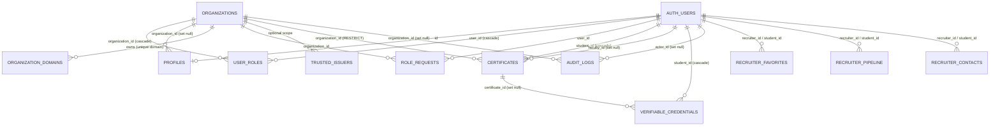

# Database schema: target design and cleanup plan

Status: the whole cleanup (`20261015_00` to `08`, plus `03b`) is applied to the production database (2026-10-15) and the matching code is deployed.
The migrations are verified against a model of the production schema (`supabase/tests`, run in CI) and were smoke-tested on the live application; see "Migration status" below for every file in the folder.
Source of truth for the *current* schema is the introspection of 2026-10-14; for *required* behaviour it is the
application code (three independent read-only analyses of every `.from()`, `.rpc()`, storage and realtime use).

## 1. Summary

| | before | after |
|---|---:|---:|
| tables | 17 | 13 |
| columns | 189 | 147 |
| indexes | 109 | 56 |
| of which secondary (not PK / constraint) | 82 | 34 |
| SQL functions | 42 | 24 |
| foreign keys | 35 | 31 |
| triggers | 5 | 18 |

(counts are from the test model, which contains the 17 live tables; policies are only partly modelled, so no policy count is quoted.)

What the cleanup achieves, in one paragraph: the database stops disagreeing with the application (7 tables and a
dozen columns the code uses did not exist, `audit_logs` was written in five different shapes and silently dropped most
of them, `role_requests.id` was a bigint while the code validates a uuid), duplicate and useless indexes go, an abandoned
second data model (`documents`) and ~25 unused SECURITY DEFINER functions go, and the rules that used to live only in
application code become database constraints and triggers (one active credential per certificate, append-only audit log,
the last admin of an organization cannot be removed, a domain belongs to one organization).

## 2. Design principles

1. **`user_roles` is the single source of truth for who may do what.** `profiles` holds profile data only. A role copy
   in `profiles` (`profiles.role`) is user-editable and nothing may trust it, so it is removed.
2. **The server is the authority for writes; RLS is the second wall.** Privileged writes use the service role after the
   application's own authorization. RLS exists so a leaked anon key or a signed-in user calling PostgREST directly can do
   only what a normal user may.
3. **Evidence is never destroyed by a cascade.** Certificates cannot be removed by deleting an organization
   (`RESTRICT`; organizations are deactivated); credentials outlive their certificate (revoked, not deleted); audit rows
   survive the deletion of their actor or organization (`SET NULL`) and cannot be edited or deleted.
4. **One shape per concept.** One audit shape, one status column per entity, one place for organization domains.
5. **Every foreign key keeps an index; every index serves a query that exists.** Booleans and 3-value status columns are
   not indexed on their own; a unique constraint is not duplicated by a plain index.
6. **Safe rollout (expand, switch, contract).** Additive changes first and compatible with the deployed code, constraints
   next, destructive changes last and only after the code no longer uses what they remove. Every drop is guarded.
7. **Defaults fail safe.** `approval_status` defaults to `pending`, privacy switches default to off, `faculty_id` etc. are
   cleared when the row leaves its state.

## 3. Target data model



### Tables that remain

| table | role | notes |
|---|---|---|
| `organizations` | tenants | one UNIQUE each on slug, e-mail, subdomain, custom_domain; `type` allows university, college, school, institute, company, enterprise; slug format check; sensitive columns changeable only by a super admin (trigger); `primary_admin_id` kept in sync with `user_roles.is_primary_admin` by trigger; deactivate (`is_active`, `deleted_at`) instead of deleting |
| `organization_domains` (new) | claimed e-mail domains | `UNIQUE(domain)`, lowercase, format-checked; replaces both `allowed_domains`-per-org and the JSON array in `organizations.settings`; kept in sync from the JSON until the code reads the table |
| `allowed_domains` | global educational suffixes (`.edu`, `ac.in`) | writable by a super admin only; no organization meaning |
| `profiles` | one row per user | adds `company_name`, `phone`, `linkedin`, `github`, `portfolio`, `public_portfolio_enabled`, `recruiter_share_contact`, `updated_at`; `gpa numeric(4,2)` (10.00 now fits); `role` and `company` removed; unique `lower(email)`; a user can only point `organization_id` at an organization they belong to |
| `user_roles` | roles per (user, organization); NULL organization = platform level | unique `(user_id, organization_id) NULLS NOT DISTINCT`; `super_admin` must be platform level; one primary admin per organization (partial unique); approval columns; legacy `is_super_admin` flag, its one-row unique index and the "first admin becomes super admin" trigger removed |
| `role_requests` | requests for a higher role | `id` is a uuid; at most one pending request per (user, organization, role) |
| `trusted_issuers` | issuer allow-list (admin CRUD only today) | name unique per organization (not globally); confidence 0..1 |
| `certificates` | the uploaded credential and its review state | `verification_status` is the truth (NOT NULL); `date_issued` is a `date`; `title`/`institution` never NULL; `verification_details jsonb`, `storage_path`, `reviewed_at` added; `faculty_id` references `auth.users` and is cleared if the reviewer is deleted; legacy `status` is a derived mirror until it is dropped |
| `verifiable_credentials` | issued, signed credentials and their revocation state | `id` stays the text `urn:uuid:...`; real `certificate_id` and `organization_id` columns (backfilled, kept in sync by trigger); status limited to active / revoked; at most ONE active credential per certificate |
| `audit_logs` | append-only trail | one shape: `actor_id`, `organization_id`, `action`, `target_type`, `target_id` (text), `details`, `created_at`; UPDATE/DELETE/TRUNCATE refused; the referential SET NULL clean-ups still work |
| `recruiter_contacts`, `recruiter_favorites`, `recruiter_pipeline` | recruiter workspace | `organization_id` NOT NULL; uniqueness on (recruiter, student) kept; redundant indexes dropped |

### Removed

| what | why |
|---|---|
| `documents` (+ the never-created `document_metadata`) | an abandoned second model: 0 rows, nothing in the UI creates one, `certificates` is what credentials, recruiters and portfolios use; also removes a duplicate approval flow |
| `verification_results`, `recruiter_org_access`, `super_admin_audit`, `migration_status` | empty or abandoned (access lives in `user_roles`; super admin events go to `audit_logs`) |
| 27 SQL functions (`drop_certificates_table`, `ensure_role`, `update_faculty_approval`, ...) | the application calls none of them; each was executable by signed-in users |
| columns `certificates.status`, `qr_code_data`, `digital_signature`, `issuer_verified`, `ocr_text`; `profiles.role`, `company`; `user_roles.is_super_admin`; `organizations.usage_stats`; `audit_logs.target_user_id` | derived, duplicated or never read/written (each drop checks the data first) |

### Feature-module tables (separate drafts, create only when you enable the feature)

`vc_status_lists` (+ `allocate_status_index`, `set_status_bit`) for `VC_STATUS_LIST_ENABLED`; `tlog_entries`,
`tlog_tree_heads` (+ `tlog_append`) for `TRANSPARENCY_LOG_ENABLED`; `sd_issuances` for `SD_JWT_ENABLED`. They have no
foreign keys on purpose (they must survive deleting credentials, certificates and users).

## 4. Index design

| table | kept / added | removed (why) |
|---|---|---|
| `certificates` | `(organization_id, verification_status, created_at desc)` faculty queue, counts, analytics; `(student_id, created_at desc)` "my certificates" and the RLS owner check; partial `(student_id, date_issued desc) INCLUDE (organization_id) WHERE verified` recruiter search / portfolio / PDF; `faculty_id` (FK) | 16 indexes: duplicates (`student_status` = `student_verification`), single-column on booleans / 3-value status / confidence / method, legacy `status`, and a full-text index nothing queries |
| `user_roles` | the unique `(user_id, organization_id)` (this is the lookup of "all roles of this user", the hottest query); `(organization_id, role, approval_status)`; partial pending; partial unique primary admin | 9 (leading-column duplicates, two unique indexes implied by the stricter unique, single-column role / approval) |
| `audit_logs` | `(organization_id, created_at desc)`, `(actor_id, created_at desc)`, `(target_type, target_id, created_at desc)`, `(action, created_at desc)` | 12 (the same four patterns existed up to three times each) |
| `organizations` | its unique constraints | 9 plain indexes duplicating those uniques or covering booleans / tiny-table scans |
| `role_requests` | `(organization_id, status, created_at desc)`, `(user_id, status)`, partial unique pending | 6 |
| `verifiable_credentials` | PK (verification does `WHERE id = <signed vc id>`), `(student_id, status, created_at desc)`, `(certificate_id)`, `(organization_id)`, partial unique active-per-certificate, partial unique status-list slot | (had none) |
| `recruiter_*` | the uniques, FK indexes, `(recruiter_id, contacted_at desc)` | prefix duplicates and a 5-value stage index |

Not done yet, deliberately: trigram (`pg_trgm`) indexes for the recruiter text search. With a dozen profiles they cost
more than they save; add them when one organization has more than roughly ten thousand students. Recruiter search also
does an N+1 scan in application code; the real fix is one SQL view or RPC (profiles join approved student role join
visibility flags join verified-certificate aggregate), which is application work, not schema.

## 5. Migration plan

Files are in `supabase/migrations/` with the prefix `20261015_`. Steps 00 to 08 are applied in production. From now on
migrations are applied automatically by a runner and a GitHub workflow, in the order and phase described in
[MIGRATIONS.md](./MIGRATIONS.md) (the files in this table carry a `-- migrate: baseline` or `skip` directive and are never
run again there). Every file is idempotent (tested).

| step | file | apply when | needs a code change first? | what it does |
|---|---|---|---|---|
| 00 | `00_preflight` | now (read-only) | no | lists blockers (duplicate e-mails, several active credentials per certificate, ...) and prints the signup trigger on `auth.users` |
| 01 | `01_expand` | now | **no** | additive: new columns, backfills, sync triggers, `organization_domains`; the deployed code keeps working |
| 02 | `02_integrity` | after 01 | no | FK delete rules, constraints, trigger fixes, append-only audit log, uuid `role_requests.id` |
| 03 | `03_indexes` | after 02 | no | add the needed indexes, drop the duplicates |
| 04 | `04_policies_safe` | after 03 | no | super-admin-only global domain list; organization admins cannot change sensitive organization fields |
| 05 | `05_lock_audit_writes` | after the audit code change | **yes (A)** | only the backend can write `audit_logs`; members stop reading each other's audit trail |
| 06 | `06_credentials_service_only` | after the issuance code change | **yes (B)** | signed-in users can no longer insert credential rows |
| 07 | `07_default_pending` | after reading the signup trigger | **verify (C)** | `user_roles.approval_status` defaults to `pending` |
| 08 | `08_contract` | after the cleanup PR | **yes (D)** | drops dead tables, functions and columns (guarded) |

`20261014_authz_03` (last-admin trigger) is superseded by step 02 (`guard_last_org_admin` + `protect_primary_admin`);
do not apply both. `20261014_authz_05a/b/c` must be applied before step 08 (it rewrites three of their policies).

### Migration status (checked against the production database on 2026-10-15)

`supabase/migrations/20261015_99_status_check.sql` is a read-only query that reports this table's "present" column from the live database.

| file | status | note |
|---|---|---|
| `20261014_00_db_hardening` | applied | |
| `20261014_authz_01_function_hardening`, `authz_04_function_hardening` | applied or superseded | the functions they harden were later removed or redefined by `20261015_08` |
| `20261014_authz_02_transfer_primary_admin` | applied | |
| `20261014_authz_03_last_admin_trigger` | superseded | replaced by `guard_last_org_admin` and `protect_primary_admin` in `20261015_02`; do not apply both |
| `20261014_authz_05a`, `05b`, `05c` | applied | helpers and the `user_roles` / `role_requests` policies |
| `20261014_authz_06_domains_unique` | applied or covered | `allowed_domains` has a unique `domain` key |
| `20261014_core_audit_logs_normalize` | applied | `audit_logs` has `target_type` / `target_id` (finished by `20261015_01` and `02`) |
| `20261014_core_revocation_list_note`, `core_storage_policies_note` | notes | no SQL effect; the storage note is superseded by `20261016_01` |
| `20261014_core_vc_one_active_per_certificate` | superseded | by `vc_one_active_per_certificate` in `20261015_03` |
| `20261014_core_vc_status_columns`, `vc_status_list_columns` | applied | the status list columns exist on `verifiable_credentials` |
| `20261014_privacy_profile_visibility` | applied | `profiles.public_portfolio_enabled`, `recruiter_share_contact` |
| `20261014_privacy_profiles_rls` | **not applied, on hold** | stricter `profiles` read policies; apply only after a week of watching the application with the current policies, because every role reads profiles through user sessions |
| `20261014_vc_status_lists` | **not applied (optional module off)** | needed only with `VC_STATUS_LIST_ENABLED=true` |
| `20261014_tlog_transparency_log` | **not applied (optional module off)** | needed only with `TRANSPARENCY_LOG_ENABLED=true` |
| `20261014_sd_issuances` | **not applied (optional module off)** | accounting table for `SD_JWT_ENABLED=true` |
| `20261015_00` to `08`, `03b` | applied | the cleanup described above |
| `20261016_01_private_certificates_bucket` | **applied 2026-10-15** (phase `post`, by the migration workflow; see [MIGRATIONS.md](./MIGRATIONS.md)) | makes the `certificates` storage bucket private and adds owner-folder storage policies; see `docs/PRIVATE-STORAGE.md` (rollback included) |
| `20261016_02_rate_limits` | **applied 2026-10-15** (phase `pre`, by the migration workflow; see [MIGRATIONS.md](./MIGRATIONS.md)) | `rate_limits` table and `rate_limit_hit` function for the global limiter; see `docs/RATE-LIMITING.md`; covered by the migration checks |

### Application changes that gate the later steps

**Status: A, B and D are implemented, deployed and verified; C was checked** (the `auth.users` table has no signup trigger, so step 07 was safe).
The order that was used: steps 01 to 04, then the code deploy, then steps 05, 06, 07 and 08. The lists below record what each gate required.

Two behaviour changes that came with step 05: faculty see only their own rows in `/api/certificates/approval-history` (the audit read policy is "own rows, or organization admin and above"), and the recruiter dashboard's "recent verifications" list is always empty (the route that wrote those audit rows was removed).

**A. Before 05 (audit writes only through the service role, one shape)**
- `src/lib/services/certificateService.ts` `writeAudit(db, ...)`, `src/app/api/vcs/revoke/route.ts` (also uses `entity_type` / `entity_id`),
  `src/app/api/credentials/sd/issue/route.ts` (same), `src/app/api/certificates/delete/route.ts`: pass the admin client.
- `src/lib/privacy/audit.ts` (`user_id` -> `actor_id`), `src/app/api/recruiter/dashboard/route.ts` and
  `src/app/api/admin/dashboard/route.ts` (read `user_id`), `src/app/api/certificates/approval-history/route.ts` (reads `target_user_id`): use `actor_id` / `target_type` + `target_id`.

**B. Before 06 (credentials written by the backend)**
- `issueCredentialForCertificate` (called from `certificates/approve/route.ts` and `certificates/issue/route.ts`) and the
  revoke paths: write `verifiable_credentials` with the service-role client after the existing authorization.

**C. Before 07:** run the last query of `00_preflight` and confirm the `auth.users` trigger inserts `approval_status`
explicitly. If it relies on the default, change the trigger to insert `'approved'` for students first.

**D. Before 08 (the cleanup PR)**
- Remove the documents subsystem: `src/app/api/documents/**`, the `document_metadata` read in `analytics/faculty`, the
  documents-first branches in the student and faculty dashboards and the two review pages.
- Remove or rewrite readers of tables that never existed: `certificate_metadata` (`certificates/metadata/[certificateId]`,
  `analytics/dashboard`, `analytics/faculty`, the `metadataId` path in `certificateService` / `certificates/approve` /
  `certificates/delete`) now read `certificates.verification_details`; `verification_results` (`analytics/dashboard`) and
  `verification_requests` (`webhooks/verification`, which nothing calls) are dropped; `recruiter/saved-searches` and
  `recruiter/verify-certificate` (no UI, write columns that do not exist) are removed.
- Stop writing columns that go away: `certificates.status` (`certificateService`: `legacyStatusFor` and the `status:` fields in
  updates and the rollback), `profiles.role` (`profile/complete`, `signup/student-faculty`, `signup/recruiter`,
  `orgAdmins.ts`, `scripts/setup-superadmin.mjs`), `user_roles.is_super_admin` (`admin/roles/route.ts` select, `admin/dashboard/page.tsx`),
  `audit_logs.target_user_id`, `organizations.usage_stats` (`src/types.ts`).
- `scripts/setup-superadmin.mjs` writes `super_admin_audit`; write `audit_logs` instead.
- Write `profiles.company_name` (and phone) at recruiter signup; the admin approval screens already read it.
- Move the organization-domain admin API (`admin/domains`, `admin/organizations/[orgId]/domains`) to `organization_domains`;
  `allowed_domains` has no organization column, so the org-scoped parts of that API cannot work today.

**Non-blocking improvements the new columns allow:** look credentials up by `certificate_id` instead of
`credential @> {...}` JSON containment (`certificateService.ts`, `credentials/sd/issue`, `vcs/revoke`, the portfolio join);
write `storage_path` next to `file_url` in `certificates/create` (the prerequisite for ever making the bucket private);
handle the unique violation (`23505`) the one-active-credential index can raise at issue time.

## 6. Row-level security model after the cleanup

| table | signed-in user | organization staff | recruiter | notes |
|---|---|---|---|---|
| `certificates` | insert own (pending only), read own | read / update (approved reviewers of that organization) | read verified of organizations they have approved access to | deletes only via backend |
| `verifiable_credentials` | read own | update (revocation) by approved staff of the owner's organization | via the backend | insert/delete backend only after step 06 |
| `audit_logs` | read rows they caused | admin and above read the organization's rows | | no client writes after step 05 |
| `user_roles`, `role_requests` | own rows; self-service pending request | org admins manage lower ranks (rank >= 80 for roles, >= 60 for requests) | | primary admin protected by restrictive policies and triggers |
| `organizations` | read own | update ordinary fields only (trigger) | | sensitive fields: super admin |
| `organization_domains` | | admin and above read | | writes by the backend only |
| `allowed_domains` | read active | | | write: super admin |

All helper functions used by policies (`authz_*`, `is_super_admin_no_rls`, ...) are approval-aware, deterministic and
have a pinned `search_path`. Policies should use `(select auth.uid())` so Postgres evaluates it once per statement; the
policies rewritten in these migrations do.

## 7. How this was verified, and what that does not prove

`supabase/tests/` rebuilds a model of the production schema (tables, constraints, indexes, triggers, functions and the
policies the migrations touch) in an in-process PostgreSQL 18 (PGlite), applies the migrations, and asserts 92 properties:
data backfills, constraints and triggers behaving as designed (including the old bugs: a first `admin` role no longer
collides with the super-admin flag, a credential id like `urn:uuid:...` can be logged), per-role policy behaviour,
the exact set of tables / functions / indexes that remain, that step 08 **refuses** to drop a table that holds data, and that
applying the whole chain twice changes nothing. A mutation test (weakening one index) is caught.

```
cd my-app/supabase/tests && npm install && npm test
```

It does **not** prove: behaviour on your real data (only seeded stand-ins with the same shape and counts), every real
policy (only the ones the migrations touch are modelled), Supabase-specific machinery (GoTrue triggers on `auth.users`,
realtime publication, storage policies), or performance at scale. Run the migrations on a staging copy first
(`supabase db dump` / branch database), run `00_preflight`, then apply step by step and run the app's smoke test after each.

## 8. Rollback notes

| step | rollback |
|---|---|
| 01 | additive; leave in place. To undo: drop the new columns / triggers / `organization_domains` |
| 02 | constraints and FKs can be dropped and re-created with the old rules; the `role_requests.id` uuid conversion is the only one-way change (2 rows); the guard triggers can be disabled with `alter table ... disable trigger` |
| 03 | re-create any dropped index from `supabase/tests/live-schema.sql` |
| 04-07 | policies / defaults can be reverted to the previous definitions (kept in `live-schema.sql` and `20261014_authz_05*`) |
| 08 | irreversible for dropped objects; take a `pg_dump` of the tables first (the guards only protect against dropping data, not against dropping something you wanted) |

## 9. Decisions made, and the one still open

Made (recommended defaults; change before applying if you disagree): remove `documents`; allow several super admins but never
zero; one `organization_domains` table; identity foreign keys point at `auth.users`; one status column per entity; do not
create `saved_searches` (no UI); drop the recruiter verification annotation (never read); keep `organizations.subscription`
as a placeholder.

Open: the body of the `auth.users` signup trigger (`assign_default_role`), which is outside the repository and decides whether
step 07 is safe. It is printed by the last query of `00_preflight`.
