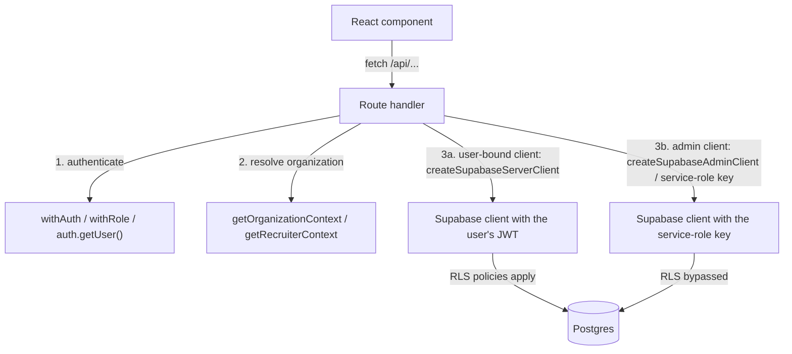

# Database access flow

How API routes reach Postgres. There are two kinds of Supabase client, and they behave very differently with respect
to Row-Level Security (RLS).



## Rules of thumb used in the code

1. **Authenticate first** (`withAuth`, `withRole`, `withSession`, `withSuperAdmin`, `recruiterRoute`, or
   `supabase.auth.getUser()`); `/api/*` is not covered by middleware.
2. **Resolve the organization** for multi-tenant data with `getOrganizationContext(user, requestedOrgId)` (or check an
   approved role in a given organization with `authorizeOrg`) and filter by `organization_id`
   (`getTargetOrganizationIds(context)` returns the list; recruiters may have several).
3. **User-bound client** (`createSupabaseServerClient`): queries run as the signed-in user, so RLS policies are the
   second line of defence.
4. **Admin client** (41 route files call `createSupabaseAdminClient()`; shared helpers such as `writeAudit` and
   `recruiterRoute` use it too): used for operations that RLS would block (creating users, role changes,
   cross-organization admin views, storage cleanup, credential issue/revoke, audit writes). Nothing but the route's own
   checks protects these queries, so each such route must verify the caller's role and the target's organization itself.
5. Prefer small, explicit `select(...)` column lists over `select('*')` for responses that reach other users.

## Query example (organization-scoped list)

```ts
export const GET = withRole(['faculty', 'admin', 'org_admin', 'super_admin'], async (req, { user }) => {
  const ctx = await getOrganizationContext(user, req.headers.get('X-Organization-ID'));
  const orgIds = getTargetOrganizationIds(ctx);
  const supabase = await createSupabaseServerClient();
  const { data, error } = await supabase
    .from('certificates')
    .select('id, title, institution, verification_status, student_id')
    .in('organization_id', orgIds);
  ...
});
```

## What RLS covers

The schema cleanup (`supabase/migrations/20261015_*`) is applied in production; the policy model per table is in
[DATABASE-SCHEMA.md](./DATABASE-SCHEMA.md) (section 6), and its "Migration status" section lists which migrations are
applied. The migrations are versioned patches, not a complete baseline dump of the original schema, so only the
policies they create or rewrite are in this repository, and this document does not list or count policies. To check
which tables have RLS enabled in a given database:
`select relname, relrowsecurity from pg_class where relnamespace = 'public'::regnamespace and relkind = 'r';`.

## Tables the code touches

See the list in [ARCHITECTURE.md](./ARCHITECTURE.md#data-stores). There is no `revocation_list` table: revocation
state lives on `verifiable_credentials`.
