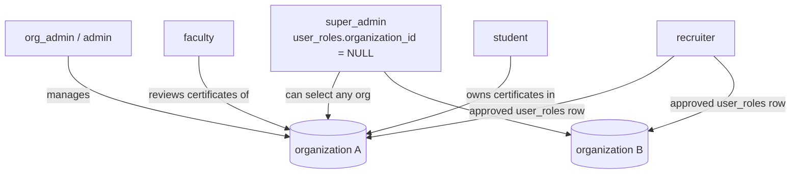

# Multi-organization design

CampusSync is multi-tenant: an *organization* is an institution. This page describes how tenancy is modelled and
enforced in the code today.

## Data model (as used by the code)

- `organizations` (`id`, `is_active`, `settings.allowed_email_domains`, primary admin, slug).
- `user_roles (user_id, role, organization_id, approval_status)`: one row per user per organization (unique on
  `(user_id, organization_id)`, nulls not distinct). The `super_admin` row and a recruiter's platform-level row have
  `organization_id = NULL`. A user can hold roles in several organizations. Only approved rows grant anything; this
  table is the only source of authorization.
- A recruiter has one platform-level row (approved by the platform) and needs one approved `user_roles` row per
  organization (`role = 'recruiter'`): they must request access to each organization
  (`/api/recruiter/request-access`); an org admin approves or revokes (`/api/admin/org/access-requests`,
  `/api/admin/org/revoke-access`; revoking sets the row to `denied`).
- Tenant-owned data (`certificates`, `audit_logs`, ...) carries `organization_id`.
- `organization_domains (organization_id, domain, created_by)`: the domains an organization claims, `UNIQUE(domain)`.
  `/api/admin/domains` and `/api/admin/organizations/[orgId]/domains` manage it; every write also rewrites
  `settings.allowed_email_domains` (merge) because sign-up still reads that JSON, and a database trigger keeps the
  two in sync (a domain claimed by another organization is rejected with 409). Wildcard overlaps (`*.x.edu` vs
  `a.x.edu`) are checked in the application before the insert.
- `allowed_domains`: the GLOBAL list of educational suffixes (`.edu`, `ac.in`), not organization data. Managed by
  super admins only through `/api/admin/domains?scope=global`.
- Sign-up for students/faculty requires an email domain listed in the organization's `settings.allowed_email_domains`;
  students are approved automatically, faculty become `pending` until an admin approves. Recruiters sign up with any
  email and need platform approval, then per-organization access.

## Roles (6)

`student`, `faculty`, `admin`, `recruiter`, `org_admin`, `super_admin`. The database requires an organization's
primary admin to be an `org_admin` and refuses to remove the last admin of an organization (see
[DATABASE-SCHEMA.md](./DATABASE-SCHEMA.md)).

## How tenancy is enforced

1. **Role gate** (`withRole`): global, "holds this role in any organization" (approved rows only).
2. **Organization gate** (`authorizeOrg` / `resolveAdminOrg` for admin actions, `getOrganizationContext` /
   `getRecruiterContext` for data scoping): picks the organization from the `X-Organization-ID` header or request body
   (an approved `user_roles` row for that organization must exist), or falls back to the user's highest-privilege
   approved row (ties: oldest). Super admins can pick any organization (without a request, the oldest active one);
   recruiters get the list of approved organizations.
3. **Query filter**: routes add `organization_id = ...` / `in (...)` to queries.
4. **RLS** (user-bound client only): blocks cross-tenant reads/writes even if a route forgets step 3. The policy model
   is described in [DATABASE-SCHEMA.md](./DATABASE-SCHEMA.md) (section 6); see also
   [Security-Auth-flow.md](./Security-Auth-flow.md).

Because step 1 is global, a route that stops after `withRole` is not tenant-scoped. 41 route files also use the
service-role client, where steps 1 to 3 are the only protection.

## Super-admin management

`/api/v2/admin/super/**` (10 route files) creates organizations, manages admins and the primary admin
(`transfer_primary_admin`, `check_and_reserve_slug`, `generate_organization_slug` RPCs) and reports platform stats.
`/api/v2/user/organization-context` returns the caller's organizations for the client-side
`OrganizationContext`/`OrganizationSwitcher`.

## Known limitations

- Role checks are global rather than per organization.
- Without `X-Organization-ID`, a user with roles in several organizations gets their highest-privilege approved
  row; clients should send `X-Organization-ID` explicitly.
- Only the policies created or rewritten by the migrations in `supabase/migrations/` are in this repository (they are
  versioned patches, not a complete baseline dump of the original schema).
