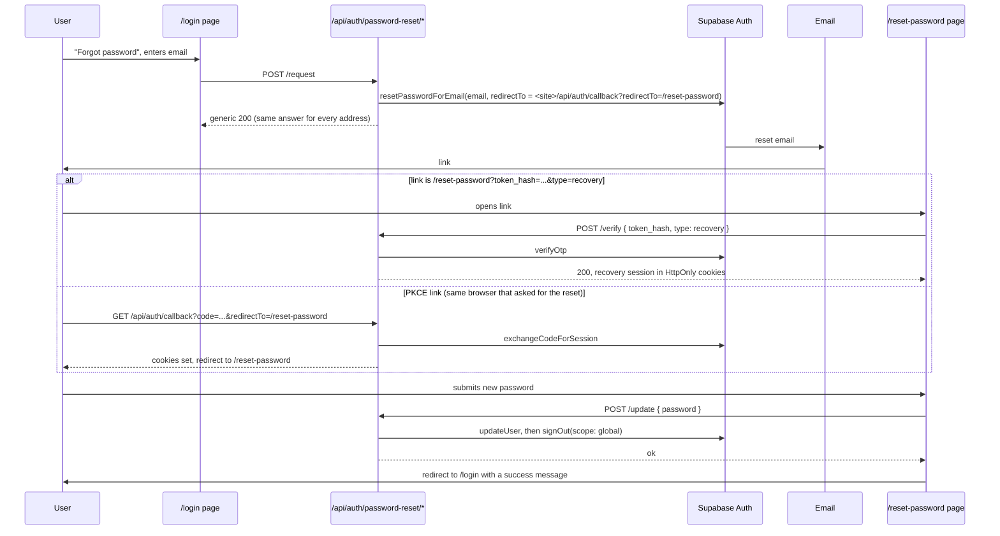

# Password reset flow

How password reset works in the current code. The whole flow runs on the server: the browser never holds a Supabase
client or a session token, and the recovery session lives in HttpOnly cookies (see
[SESSION-COOKIES.md](./SESSION-COOKIES.md) for the cookie model, the dashboard settings and the smoke checklist). The
email template guidance lives in [`SUPABASE_EMAIL_TEMPLATES.md`](./SUPABASE_EMAIL_TEMPLATES.md).

## Routes

| Route | Purpose |
|---|---|
| `POST /api/auth/password-reset/request` | Asks Supabase to send the reset email. Always answers 200 with a generic message, so it does not reveal whether an address has an account. Limited per client address and per mailbox (in-memory limiter). The server stores the PKCE verifier cookie. |
| `POST /api/auth/password-reset/verify` | Exchanges the single-use `token_hash` from the email link for a recovery session and sets it in HttpOnly cookies. Rate limited. |
| `GET /api/auth/callback?redirectTo=/reset-password` | The PKCE `code` variant: exchanges the code, sets the cookies, then goes straight to `/reset-password`. |
| `POST /api/auth/password-reset/update` | Needs the recovery session cookie. Applies the password rule (8 to 72 bytes), sets the new password, then ends **all** of the user's sessions. The user logs in again. Rate limited. |

## Sequence

## Configuration

- Supabase dashboard, Authentication, URL Configuration: set the Site URL to the production origin and add
  `<site>/api/auth/callback**` and `<site>/reset-password` to the redirect allow-list. The allow-list entry for the
  callback is required: the reset email's `redirectTo` is `<site>/api/auth/callback?redirectTo=%2Freset-password`, and
  Supabase falls back to the Site URL when a `redirectTo` is not on the list.
- Supabase dashboard, Email Templates: the template can keep the `token_hash` link
  (`{{ .SiteURL }}/reset-password?token_hash={{ .TokenHash }}&type=recovery`). Both link styles work; the PKCE-code style
  only works in the **same browser** that requested the reset, because the verifier cookie is there.
- `NEXT_PUBLIC_SITE_URL` should be the production origin; the request route falls back to the request origin.

## Behaviour to know

- The reset page logs only short messages to the browser console, never URLs or tokens. A recovery token is a
  credential until it is used.
- The `/update` route accepts any valid session, not only a recovery session (the previous browser-side flow behaved
  the same way). Supabase's "require current password / recent login to change password" project setting tightens it.
- Token lifetime and reuse rules are Supabase settings, not enforced by this repository.
- The limiters on the four routes are the in-memory, per-instance limiter (`src/lib/rateLimit.ts`), a best-effort
  brake on serverless hosting. The global Postgres limiter is not wired to these routes (see
  [RATE-LIMITING.md](./RATE-LIMITING.md)).
- The old `/api/auth/check-user-exists` call is no longer part of the reset flow.
