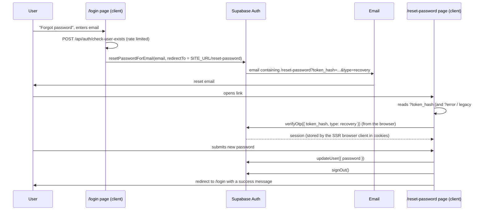

# Password reset flow

How password reset works in the current code. The email template guidance lives in
[`SUPABASE_EMAIL_TEMPLATES.md`](./SUPABASE_EMAIL_TEMPLATES.md).

## Summary

- The reset page (`src/app/reset-password/page.tsx`) is a **client component**. It exchanges the one-time
  `token_hash` from the email link by calling `supabase.auth.verifyOtp({ token_hash, type: 'recovery' })`
  **in the browser**. The middleware does not take part in the exchange.
- The session is stored by `@supabase/ssr`'s browser client in cookies written from JavaScript. These cookies are
  **not HttpOnly** (JavaScript on the page can read them), so XSS on the origin could read them. Treat XSS prevention
  and a strict Content-Security-Policy as the mitigation, not cookie flags.
- The middleware matcher covers `/reset-password`, but it only refreshes the session and treats that route as public.
  It does not read `token_hash`.

## Sequence

## Steps

1. **Request.** `src/app/login/page.tsx` first calls `/api/auth/check-user-exists` and then
   `supabase.auth.resetPasswordForEmail(email, { redirectTo: <site>/reset-password })`.
2. **Email.** Supabase sends the template configured in the dashboard. The template must link to
   `{{ .SiteURL }}/reset-password?token_hash={{ .TokenHash }}&type=recovery`.
3. **Landing.** The page checks for an `error` query parameter, warns if it sees the legacy hash format
   (`#access_token=`), reuses an existing session if there is one, and otherwise calls `verifyOtp` with the
   `token_hash`.
4. **Update.** `supabase.auth.updateUser({ password })`, then `signOut()` and a redirect to `/login`.

## Configuration

- Supabase dashboard, Authentication, URL Configuration: set the Site URL and add `<site>/reset-password` to the
  redirect allow-list.
- Supabase dashboard, Email Templates: use `token_hash` links as above.
- `NEXT_PUBLIC_SITE_URL` is used to build `redirectTo` (falls back to `window.location.origin`).

## Known limitations

- The reset page currently logs diagnostic details (including URL parameters such as `token_hash`) to the browser
  console. Those logs should be removed; a recovery token is a credential until it is used.
- Token lifetime and reuse rules are Supabase settings (not enforced by this repository).
- `/api/auth/check-user-exists` reveals whether an email is registered (user enumeration); it is rate limited
  in-process only.
