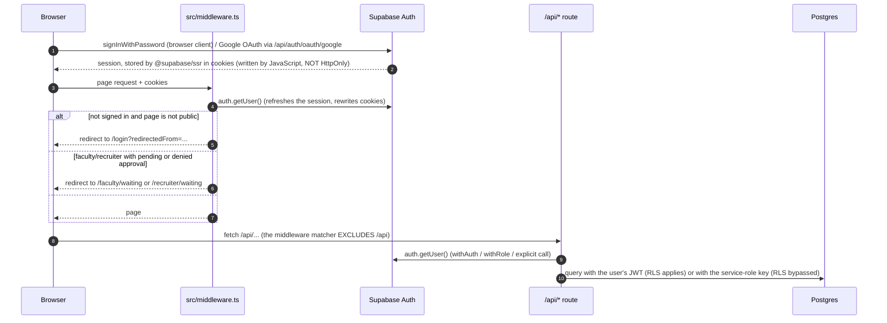

# Security and authentication flow

This page describes what the code actually does. For the broader picture see [ARCHITECTURE.md](./ARCHITECTURE.md).

## Sign-in and session

Key points:

- Cookies are **not** HttpOnly. `@supabase/ssr`'s browser client sets them from JavaScript so that the client can
  read and refresh the session. XSS on the origin would expose them; there is no server-side session store.
- The middleware **authenticates and redirects only**. It never returns 403 and does not check role permissions
  for pages. Authorization is enforced in API routes (and by RLS where a user-bound client is used).
- `/api/*` is excluded from the middleware matcher, so every route authenticates itself. The list of routes without
  a recognised guard, each with a justification, is `tests/security/route-inventory.test.ts`.
- Nothing sets Postgres session variables such as `organization_id` or `role` for RLS. Any RLS policy has to derive
  tenancy from `auth.uid()` and table lookups (for example `user_roles`) or JWT claims, not from custom settings.

## Authorization in routes

| Helper | File | Behaviour |
|--------|------|-----------|
| `withAuth(handler)` | `src/lib/api/middleware/auth.ts` | 401 when `auth.getUser()` fails. |
| `withRole(roles, handler)` | same | 403 unless `requireRole(roles)` succeeds. |
| `requireRole(roles)` | `src/lib/supabaseServer.ts` | Uses the user's highest-priority role across all organizations; rows with `approval_status` `pending`/`denied` are refused. |
| `getOrganizationContext(user, orgId?)` | `src/lib/api/utils/organization.ts` | Resolves the organization (header `X-Organization-ID` / body `organization_id`, verified against `user_roles`); super admins may pick any, recruiters get their approved `recruiter_org_access` set. |

Roles (6): `student`, `faculty`, `admin`, `recruiter`, `org_admin`, `super_admin`.

`withRole` is a global check (role held in any organization). Multi-tenant routes must additionally scope by
organization with `getOrganizationContext` and filter queries by `organization_id`.

## Service-role usage

35 route files use the service-role client, which bypasses RLS. In those routes the explicit checks in the route are
the only access control. Review any new use carefully, and never import the admin client into client components
(a test fails if `process.env.SUPABASE_SERVICE_ROLE_KEY` appears in `page.tsx` or `src/components`).

## Database security model (observed 2026-10-14)

RLS policies are **not in this repository**; see the drafts in `supabase/migrations/` (marked DRAFT, review before
applying). What the owner observed in production:

- RLS enabled on `certificates`, `profiles`, `role_requests`, `user_roles`, `verifiable_credentials`.
- The database policy set was reviewed and tightened by the SQL in `my-app/supabase/migrations/` (drafts: review against the live schema before applying). Specifics are intentionally not described in this public repository.
- The `certificates` storage bucket is public.
- Table `revocation_list` does not exist; revocation lives on `verifiable_credentials`.

## Other controls

- Public endpoints that are expensive or sensitive use the in-memory limiter in `src/lib/rateLimit.ts`
  (per instance; not a distributed limit).
- Webhooks (`/api/webhooks/verification`) verify an HMAC-SHA256 signature with `WEBHOOK_SECRET`.
- Redirect targets after login are validated by `src/lib/safeRedirect.ts`.
- Credentials are signed with the key in `VC_ISSUER_JWK`; see SECURITY.md for rotation.

- `next.config.ts` sets security headers (HSTS, `X-Frame-Options: DENY`, `nosniff`, a Content-Security-Policy that still
  allows `'unsafe-inline'` scripts, and others). Header values are configuration, not a guarantee of XSS safety.

## Not implemented

- MFA, HttpOnly session cookies, distributed rate limiting, audit-log tamper protection.
