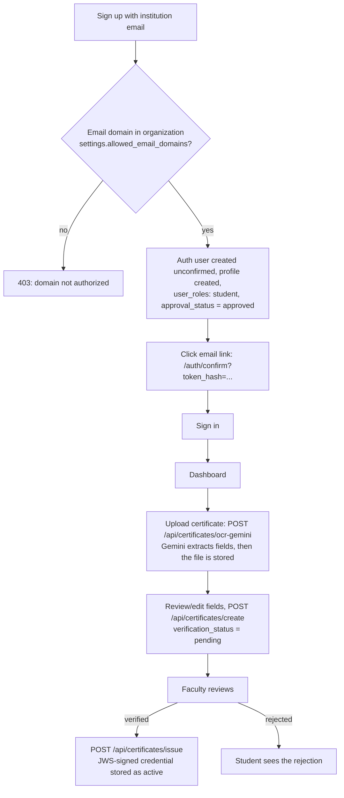

# User workflows

End-to-end flows as implemented. Role and approval data live in `user_roles (role, organization_id, approval_status)`.

## Students

Extraction uses Google Gemini only (there is no second OCR engine). It is advisory; a reviewer decides. The role row
and the profile are created at sign-up (the confirmation link only confirms the email address). A reviewer can also
issue the credential in the same request that approves the certificate (`issue: true` on
`POST /api/certificates/approve`).

## Faculty

Same sign-up path with the `faculty` role, but `approval_status = pending`. The middleware sends pending/denied faculty to
`/faculty/waiting` (which subscribes to realtime changes). An organization admin approves the request
(`/api/admin/role-requests/[id]/approve`), after which the faculty member can list pending certificates and
approve, reject or revert approvals; each action writes an `audit_logs` row. Faculty and admins can revoke a
credential (`POST /api/vcs/revoke`).

## Recruiters

Recruiters sign up with any email (`/api/auth/signup/recruiter`) and get a `recruiter` role with
`organization_id = NULL` and `approval_status = pending`; they wait on `/recruiter/waiting` for platform approval.
After that they request access to individual organizations (`/api/recruiter/request-access`) and an organization admin
approves or revokes (`/api/admin/org/access-requests`, `/api/admin/org/revoke-access`). Approved recruiters search
students and verify credentials in the approved organizations, and keep favorites, a pipeline and contacts. What a
recruiter sees of a student depends on the student's privacy switches (default off). Public verification endpoints
do not require sign-in.

## Organization admins

`admin` / `org_admin` roles are not self-service: they are granted by a super admin
(`/api/admin/roles/change`, `/api/admin/invite`, `/api/v2/admin/super/organizations/**`). They approve faculty and
recruiter requests and see organization analytics.

## Super admin

The first super admin is created with `node scripts/setup-superadmin.mjs` (see `scripts/README.md`). Super admins create
organizations (with allowed email domains), appoint admins and the primary admin, and view platform-wide stats under
`/admin/super`.

## Password reset and email confirmation

See [Password-reset.md](./Password-reset.md) and [SUPABASE_EMAIL_TEMPLATES.md](./SUPABASE_EMAIL_TEMPLATES.md).

## Notes

- Flows depend on Supabase configuration (email templates, redirect URLs) and on database policies described in
  [DATABASE-SCHEMA.md](./DATABASE-SCHEMA.md); see also [Security-Auth-flow.md](./Security-Auth-flow.md).
- Public portfolio pages exist (`/public/portfolio/[userId]`, `GET /api/public/portfolio/[userId]`). They serve only
  students who switched on `profiles.public_portfolio_enabled` (default off); every other id returns the same 404. They
  list verified certificates (title, institution, date and the active credential), not descriptions, scores or files.
- Selective-disclosure share links (`/student/share`, `/verify/sd`) and the public transparency log page
  (`/transparency`) exist in the code but are off by default and **not enabled in the production deployment**; see
  [SELECTIVE-DISCLOSURE.md](./SELECTIVE-DISCLOSURE.md) and [TRANSPARENCY-LOG.md](./TRANSPARENCY-LOG.md).
- Anyone can verify a credential without signing in: `/verify` in the browser, `GET /api/vcs/verify`, or the offline
  verifier in `../../verifier`.
